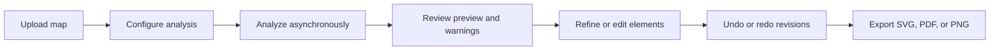

# Bringing Roadmaps to Life 
AI Learning Differences Hackathon @ Harvard

# Web App Roadmap

This document is a guide to how the current web app works, from the first upload through export. It describes the implementation as it exists today. It is getting update everytime during this hackathon!

## What the app does

Our app Bridging Roadmaps for Learning (BRL) turns an uploaded map image into a structured, editable representation. It can identify visible geometry and labels, let a person review and change the result, and render visual files for download. Analysis is approximate, so the generated representation is a starting point for human review, not a verified map or a certified tactile product.

## User journey

1. **Start a project.** The browser checks the app branding, processing status, and available recognition engines. A PNG, JPEG, or WebP image is uploaded to create a temporary project. The API validates the image, applies EXIF orientation, converts it to RGB, and prepares an analysis copy no larger than 1800 by 1800 pixels. The original is retained for comparison.
2. **Choose analysis settings.** Easy Mode uses the current configuration. Advanced Mode exposes engine, language, map type, preprocessing, included feature categories, density, simplification, and output settings. Preferences such as theme and default settings are saved in the browser.
3. **Analyze.** The browser submits the configuration and starts an asynchronous job. It polls the job endpoint for status and progress. When the job completes, it fetches the project representation and generated preview.
4. **Review and refine.** The preview can be compared with the source, zoomed, and reviewed alongside warnings. Users can change an element's label, category, or visibility, or describe a change in the refinement panel. The API stores each successful change as a revision; undo and redo select an earlier or later saved revision.
5. **Export.** The app generates SVG, PDF, or PNG from the current representation and provides a download. Export layout warnings are advisory and should be reviewed before production.

